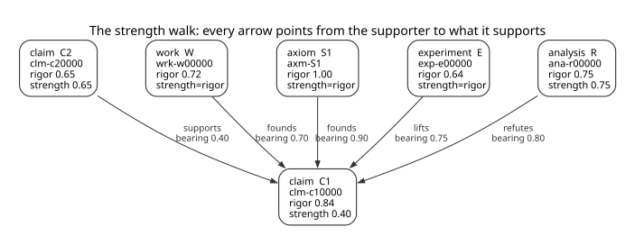

## The graph

Every arrow runs from the supporter to what it supports, the way the verb reads: C2 *supports* C1,
S1 *founds* C1, W *founds* C1, E *lifts* C1, R *refutes* C1. Every box lists `rigor` first and
`strength` last, and each line contains a value or says why there is none. A claim or an analysis has
both: its own `rigor` and the `strength` that strength propagation derives. A work, an experiment or an axiom has no
derived value of its own — its `rigor` *is* its strength, which is what its edges multiply — so its
box names both and marks the second `strength=rigor`. An axiom's `rigor` is `1.00` by rule, and no
authored file contains it. Each edge is labelled with its relation and its `bearing`.

Two boxes have a strength whose premises this fragment does not draw: R's `0.75` and C2's `0.65`. A
claim with no incoming scoring edge reads `0`, so neither value could hold without a premise set
outside the picture — R is a refuter whose derivation lies outside the fragment, and C2 stands on
premises not shown. An analysis is constituted by the nodes it cites, so one carrying no premise is
its own method's case rather than a claim's: strength propagation reads it at its `rigor` (§ The walk), and the
fragment contains none.

C1's box has `strength 0.40`, the value the sheet draws and the bands read. The `0.26` the min
derives is not a value any node has: a lift is placed above it and a refutation caps it, and those
compositions are the worked example below.

`readme-assets/strength-walk.dot` is the image's source and the file to review;
`readme-assets/strength-walk.svg` is its rendering, generated by `just strength-walk` and never
edited by hand.

