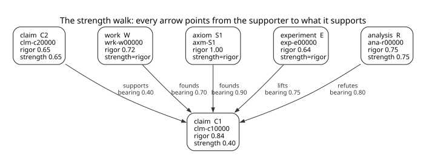

# Strength, edge by edge

The claim graph: five node types, three quantities, four scoring relations, and the
arithmetic that turns them into a number. This page is the scoring model's statement; [SPEC.md](SPEC.md)
§10 carries the format, and [ARCHITECTURE.md](ARCHITECTURE.md) the implementation.

## The three values

Each value is a number in `[0,1]` or `*pending*`.

| value | meaning |
|---|---|
| `rigor` | one node's own worth – the quality of a claim's statement, an analysis's method, or a work's soundness |
| `bearing` | one scoring edge's relevance (relevance of the source node to the target node) |
| `strength` | computed from rigor and effects of incoming edges – what the sheet draws and bands use |

Rigor and bearing are orthogonal values. A source may be exquisite, but have no bearing on the node
it is supposed to support. It may also be shoddy, but exactly on point.

A low bearing is not a verdict on the work. It says the claim does not stand on this work — a fact
about the link's construction, not the work's soundness — and the work's `rigor` is unchanged.
The remedy is to remove the entry if the work is irrelevant to the claim, or re-judge the bearing if
it is not.

## The nodes

| node | id | local value | derived |
|---|---|---|---|
| `claim` | `clm-xxxxxx` | `rigor` (its statement's own quality) | `strength` derived |
| `analysis` | `ana-xxxxxx` | `rigor` (its method's own quality) | `strength` derived |
| `work` | `wrk-<key>` | `rigor` (the paper's soundness) | none — `rigor` is the source strength |
| `experiment` | `exp-xxxxxx` | `rigor` (the method's soundness) | none — `rigor` is the source strength |
| `axiom` | `axm-<label>` | `rigor` `1.00` by rule — no authored file carries it | none — `rigor` is the source strength |

A claim is a bare statement, and its `rigor` is the quality of the assertion its text makes — fixed,
consistent, single-sensed — never the quality of an argument, which a claim does not display. A
derivation belongs in an analysis or an experiment, and reaches the claim through an edge; an
analysis's `rigor` is the quality of the method it displays against what it sets out to establish.
Whether anything carries a node is `strength`'s business, and the walk below says how.

## The four scoring relations — all point at what they support

The two minimum relations split by where the premise comes from: `supports` carries the node's own
premises, and `founds` carries support from outside its text — a cited work, or an axiom the node
leans on. An axiom's being declared in `axioms.md` is bookkeeping; what it states is an external
fact, and that is what `founds` records.

| relation | source → target | bearing feeds | arithmetic |
|---|---|---|---|
| `supports` | claim / experiment → claim or analysis | supporter's strength | multiply, into the min |
| `founds` | work / axiom → claim or analysis | the source's rigor (an axiom's is `1.00` by rule) | multiply, into the min |
| `lifts` | analysis / experiment → claim or analysis | lifter's strength | multiply, max above the min |
| `refutes` | claim / analysis / experiment → claim or analysis | refuter's strength | cap: `1 - (bearing * strength)` |

Unscored relations:

| relation | source → target | bearing | arithmetic |
|---|---|---|---|
| `references` | claim → claim | — | not scored |
| `demoted` | claim → claim (at build time only, for breaking cycles) | — | not scored |

An axiom premise is a `founds` edge from an axiom; it carries its bearing like every scoring edge,
and the axiom's `rigor` of `1.00` by rule leaves its contribution the bearing alone.

## The graph



Every arrow runs from the supporter to what it supports, the way the verb reads: C2 *supports* C1,
S1 *founds* C1, W *founds* C1, E *lifts* C1, R *refutes* C1. Every box lists `rigor` first and
`strength` last, and each line holds a value or says why there is none. A claim or an analysis has
both: its own `rigor` and the `strength` the walk derives. A work, an experiment or an axiom has no
derived value of its own — its `rigor` *is* its strength, which is what its edges multiply — so its
box names both and marks the second `strength=rigor`. An axiom's `rigor` is `1.00` by rule, and no
authored file carries it. Each edge is labelled with its relation and its `bearing`.

Two boxes carry a strength whose premises this fragment does not draw: R's `0.75` and C2's `0.65`. A
node with no incoming scoring edge reads `0`, so neither value could hold without a premise set
outside the picture — R is a refuter whose derivation lies outside the fragment, and C2 stands on
premises not shown. That is no analysis standing bare: an analysis is constituted by its citations,
and one with none is a claim.

C1's box carries `strength 0.40`, the value the sheet draws and the bands read. The `0.26` the min
derives is not a value any node holds: a lift stands above it and a refutation caps it, and those
compositions are the worked example below.

`readme-assets/strength-walk.dot` is the image's source and the file to review;
`readme-assets/strength-walk.svg` is its rendering, generated by `just strength-walk` and never
edited by hand.

## The walk

```
Let n be a claim or an analysis. ⊥ means "no number yet"; D is 0 where the premise set is empty,
and an empty lift set contributes −∞ and an empty cap set +∞, so neither changes anything.

r(n)  = n's authored rigor, or ⊥
σ(m)  = the published strength of a claim or an analysis m;
        the authored rigor of a work or an experiment; 1.0 for an axiom,
        its rigor by rule
b(e)  = the bearing authored on edge e, or ⊥
·     = an operand that is absent wherever either factor is ⊥

P(n)  = { b(e)·σ(e) : e ∈ supports(n) ∪ founds(n), e contributes }
D(n)  = 0                      where P(n) = ∅
D(n)  = min({ r(n) } ∪ P(n))   otherwise
L(n)  = max{ b(e)·σ(e) : e ∈ lifts(n), e contributes }
C(n)  = min{ 1 − b(e)·σ(e) : e ∈ refutes(n), e contributes }

max(⊥, −∞) = ⊥     max(⊥, x) = x     max(x, −∞) = x
min(⊥, c)  = ⊥      min(x, +∞) = x

σ(n)  = min( max(D(n), L(n)), C(n) )
```

**`r(n)` caps what the premises establish, and is not a premise.** Where `P(n)` is empty no premise
carries the node, and `D(n)` is `0` whatever `r(n)` says — judged, pending or absent. Support is
structural: the walk reads that nothing supports the node without knowing how good the node's own
text is, so it does not wait for a judgement. Where `P(n)` is non-empty and `r(n)` is pending, `D(n)`
stays `⊥`, because `min(⊥, c) = ⊥`. The asymmetry is the rule's content: an absent cap is unknown, an
absent premise is nothing.

`⊥` is "no number", not a small one: a lift over an unjudged node publishes the lift, and a cap over
one publishes nothing. So an empty `P(n)` with a pending `r(n)` publishes `0` — or the lift standing
over it — and not `⊥`, while a non-empty `P(n)` with a pending `r(n)` stays `⊥` and a lift standing
over it publishes the lift's product. The walk carries full precision, so a dependent multiplies its
source's exact strength. The record writes a value to four decimals — trailing zeros trimmed, and
more only where four would lose it, so it reads back as the value; a query result carries the value
at two decimals and the trace prints it, and a `verify` message quotes the record. The trace on a
`- strength:` line prints the innermost station first, so the formula reads back: the min, the lift
above it, then the cap.

## One premise, and none

`lifts` and `refutes` compose around `D` as the formula states. A node whose only incoming scoring
edge is a lift takes `max(0, L) = L`: that product is a contribution through an edge, and an empty
premise set does not suppress it. A node whose only incoming edge is a refutation takes
`min(0, C) = 0`: a cap is a ceiling and never a floor, so an attack with nothing under it
establishes nothing. A node with no incoming scoring edge at all has an empty `L` and an empty `C`,
and lands `0`.

One premise proves the weaker of the two things in play — the claim's own statement and the premise's
contribution — and no premise proves nothing. Let `c` be a supporting edge's contribution,
`b(e)·σ(e)`, and `r` the claim's rigor:

| a claim | rigor | strength |
|---|---|---|
| one supporting edge with contribution `c` | `r` | `min(r, c)` |
| no supporting edge | `r` | `0.00` |

The first row is the claim standing on one thing: the premise carries it and the statement caps it,
so a premise worth more than the statement cannot make the claim worth more than its statement, and a
thin premise gives it less. The second row is the bare claim, where `r` does not enter at all. A bare
claim whose statement fires nothing is the case `r = 0.95`, the statement vocabulary's maximum
([RIGOR_AND_BEARING_SCORING_SCHEME.md](RIGOR_AND_BEARING_SCORING_SCHEME.md), "The statement table"):
`0.95` rigor and `0.00` strength — a statement fully specified, consistent and single-sensed, with
nothing carrying it. What it proves is what it says, and nothing about whether anything supports it.

## Worked example

```
  supports   C2 -> C1   bearing 0.40 x strength 0.65 = 0.26
  founds     W  -> C1   bearing 0.70 x strength 0.72 = 0.50
  founds     S1 -> C1   bearing 0.90 x strength 1.00 = 0.90
  D(C1)                 min(rigor 0.84, C2 0.26, W 0.50, S1 0.90) = 0.26
  lifts      E  -> C1   bearing 0.75 x strength 0.64 = 0.48
  max(D, L)             max(0.26, 0.48) = 0.48
  refutes    R  -> C1   cap = 1 - (bearing 0.80 x strength 0.75) = 0.40
  σ(C1)                 min(0.48, 0.40) = 0.40
```

W's product is `0.504`: the min is the same at full precision and at the two decimals the page prints.
S1 is the axiom shape: its `rigor` is `1.00` by rule, so the contribution is the bearing alone. Its
`0.90` sits in the min beside the others and does not bind — a premise stronger than the weakest link
changes nothing.

Change one bearing and the graph answers differently:

- `supports` bearing `1.0` (C2) → contribution `0.65`, derivation `min(0.84, 0.65, 0.50, 0.90) = 0.50`.
- `founds` bearing `0.0` (W) → contribution `0`, derivation `0`: the work is not what the claim stands
  on.
- `lifts` bearing `1.0` → lift `0.64`, so `max(D, L) = 0.64` before any cap.
- every premise excluded (C2, W and S1 all pending) → `P(C1)` is empty and `D(C1) = 0`, so
  `max(D, L) = 0.48` is the lift's product alone; the cap still holds C1 at `0.40`.

## Pending: an edge either participates or does not

| state | effect |
|---|---|
| pending `rigor` | where `P(n)` is non-empty the derivation has no number; where it is empty the node reads `0`. A lift over it still publishes the lift's product |
| pending `bearing` | the edge does not participate: no link in the min, no lift, no cap. As the node's only edge it leaves `P(n)` empty and the node reads `0` |
| no source strength | the edge does not participate either: a premise whose own strength is pending, and any edge from a non-run experiment, add no operand. As the node's only edge it likewise reads `0` |
| `bearing 0.0` | participates with zero: the claim's min goes to zero |
| pending refute | no cap; an unfinished attack establishes nothing, and a cap alone publishes no number where the derivation is `⊥` |

**An edge that does not contribute is no supporter.** A pending bearing, a pending source strength,
an edge from a non-`run` experiment and a premise the walk no longer holds all add no operand, so
where such an edge is the node's only one `P(n)` is empty and the node reads `0`: an unjudged bearing
is not support yet, and a target behind one reads `unsubstantiated` until that bearing lands, never
`*pending*`. `bearing 0.0` reaches the same `0` by the other road — it participates, and the min
takes the zero — and the two stay different states in the record whatever the strength reads.

`bearing *pending*` is the absence of a judgement, so the edge is excluded. `bearing 0.0` is the
judgement that the supporting thing does not apply, so the edge participates and drags the min to
zero. Never judged and judged-irrelevant are different states, and their scores coincide only where
the min reaches `0` either way — most plainly where the edge is the node's only one: `0.0` empties
the min by taking it to zero, an excluded edge empties it by leaving no operand, and both read `0`.
The difference is the record's and the re-judge's, not the strength's. A source with no strength is
the first case, not the second: there is nothing to multiply, so there is no product.

## Authoring and storage

The register is claim-centric: a claim lists what it rests on.

| register (claim C1) | stored edge (push) |
|---|---|
| `- rests-on:` | |
| `  - clm-c20000 — the lemma (strength 0.65) (bearing 0.40)` | `clm-c20000 --supports--> clm-c10000` |
| `  - wrk-w00000 — A Cited Work (bearing 0.70)` | `wrk-w00000 --founds--> clm-c10000` |
| `  - Axiom S1 — a labelling rule (bearing 0.90)` | `axm-S1 --founds--> clm-c10000` |

A bullet's target decides the relation: a `clm-` or `exp-` token is a `supports` edge into the entry,
and a `wrk-` or `Axiom …` token a `founds` edge into it. An axiom is cited by its label, so `Axiom S1`
is the node `axm-S1`. An `ana-` token is refused — an analysis lifts or refutes and never supplies a
premise — and so is a bullet naming more than one scoring target.

`deps <id>` reads the stored edges from the reader's side: every incident scoring edge, plus the
node's own outgoing `references` and `demoted` edges, each with `direction` (`in` = the other end
supports this node, `out` = this node supports the other), the other end, and its `bearing` — null on
a row that cannot carry one.
